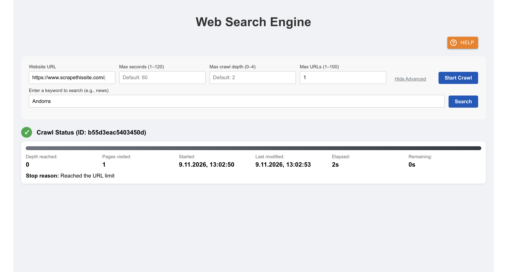
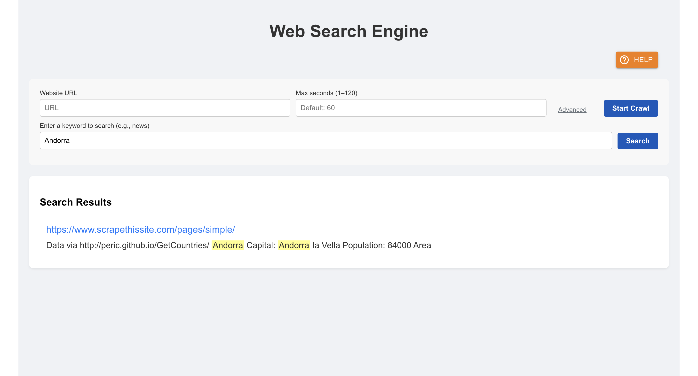

# Distributed Web Search Engine — Frontend

A React and TypeScript interface for starting web crawls, following their progress, and searching the indexed pages. The app uses Material UI, Chart.js, and Axios.

[Live demo](https://esearchengine.vercel.app/) · [Backend repository](https://github.com/elad9219/searchengine)

## Try the demo

### Start and monitor a crawl

1. Paste `https://www.scrapethissite.com/pages/simple/` into **Website URL**.
2. Open **Advanced** and set **Max URLs** to `1`.
3. Select **Start Crawl**. Wait for the status panel to show that one page was visited and the URL limit was reached.

The status panel shows the pages visited, depth reached, elapsed time, and stop reason. You can also stop an active crawl from this panel.



### Search indexed pages

Enter `Andorra` in the search field and select **Search**. The result links to the indexed page and highlights the matching term in the excerpt. Search uses the shared demo index, which can include pages from earlier crawls.



### Crawl settings

| Setting | Range | Default |
| --- | --- | --- |
| Max seconds | 1–120 | 60 |
| Max crawl depth | 0–4 | 2 |
| Max URLs | 1–100 | 25 |

A depth of `0` attempts only the starting page. If the demo reaches its shared crawl-start limit, wait a minute before trying again.

## Run locally

You need Node.js and npm. First start the API and its dependencies using the [backend setup instructions](https://github.com/elad9219/searchengine#run-locally). Then run these commands from the frontend repository root.

```bash
npm ci
npm start
```

Open [http://localhost:3000](http://localhost:3000). The development build reaches the API using the current browser hostname on port `8080`. The production build uses the hosted API configured in [`src/utils/globals.ts`](src/utils/globals.ts).

## Hosted backend warm-up

The production build sends a background health check when the page opens. The waiting message appears when a user request enters the retry flow. Before a write request, the client checks backend readiness and sends the write at most once.

## Tests and build

```bash
CI=true npm test -- --watchAll=false --runInBand
CI=true npm run build
```

The tests cover crawl input validation, progress and stop controls, search results and error states, and the API client's warm-up and retry behavior. The production build is generated in `build/`.

## Contact

Elad Tennenboim · [Portfolio](https://eladt-portfolio.vercel.app/) · [GitHub](https://github.com/elad9219) · [LinkedIn](https://www.linkedin.com/in/elad-tennenboim/) · [Email](mailto:elad9219@gmail.com)